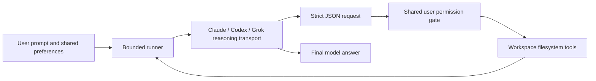

# Standalone architecture

`permissions.py` loads one immutable user policy. `adapters.py` invokes official
subscription clients with constrained native tools and provider-owned logins.
`protocol.py` parses model output as data; `runner.py` bounds the conversation;
`broker.py` is the sole filesystem effect writer. `process.py` bounds process
lifetime. `cli.py` provides setup, login, diagnostics, run and smoke commands.
No module imports Atlas or requires its services.

Client failure never triggers account/API/provider fallback. Timeouts kill the
spawned process group and surface without retry. Final text stays a model claim;
actual broker effects are separate observations.

This release supports file reads, listing and atomic writes. Other capabilities
and desktop automation explicitly refuse. Historical reading copies under
`reference/` are not imported or included in the installed wheel.

`codex_app.py` is the default new-user route. `auto_send` sends through the
Codex CLI on the ChatGPT login, then opens `codex://threads/<session-id>`;
`prefill` opens `codex://threads/new?prompt=` and the user presses Send. The
opener and runner are injectable; neither mode falls back to the other, another
provider or API billing.

`claude_app.py` auto-sends by default through the Claude Code CLI on the
user's subscription login (`claude auth login`, paid plan, separate from the
desktop app login) and returns `claude --resume <id>`; the desktop app has no
documented link to open that session. `prefill` (opt-in) opens
`claude://code/new?q=` or `claude://claude.ai/new?q=`. No API billing fallback.
