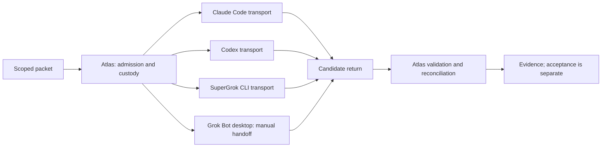

# Architecture and reading guide

## Existing implementation

`reference/shared/build_cmd.py.txt` builds argv from a configured route. It
supports an inline packet, a pointer prompt, or a file argument, appends the
dispatch contract, invokes model routing/receipt writers, and refuses configured
forbidden flags. Those routing and receipt seams belong to Atlas and are not
included as a standalone implementation.

`lane_identity_args` chooses a new explicit session ID or resumes the same ID.
`confirm_lane_started` records a session only after the existing success check.
They depend on Atlas lane configuration and state. They do not establish a
cross-provider session protocol, authentication, or safe concurrent ownership.

The Claude Courier endpoint is a separate existing implementation. It checks the
client identity/version, constrains permissions and environment, and distinguishes
the model's structured claim from system observations. Historical version pins
are evidence about those versions, not compatibility guarantees for today's CLI.
Its imports depend on permission_policy, telemetry and provenance; related source
is included for reading. Ledger, scheduling and effect authority stay outside.

The Codex route uses the shared dispatcher. The example config illustrates its
read-only CLI/output-file shape, without copying a local executable or account
configuration. Generic command assembly is not proof of Codex session handling,
provider authentication, or current CLI compatibility.

The Grok launcher adds launch registration, isolated HOME handling, a subscription
route guard, permissions, return retrieval and checkout checks. The return
validator binds candidate text to an observed SHA. Its source remains separate
from the launcher snapshot; see the manifest and release gaps.

## Offline demonstration boundary

The walkthrough selects only `build_cmd` from the reference text with Python AST.
It supplies an in-memory routing stub and receipt collector. These are explicitly
demo substitutions, not qualified routing or persistence. It then runs the actual
Grok validator against temporary synthetic outputs, including a wrong-SHA claim.
No complete dispatcher or provider launcher is imported or run.

## Planned contract versus shipped code

Atlas's existing communication plan calls for one handoff envelope, many adapters,
explicit custody acknowledgement and a typed result envelope. That consolidation
is unfinished (DOM-451 / DOM-580); this extraction does not implement or claim it.
In particular, a well-formed return is not authentication, external effect proof,
reviewer independence, or authority to merge or install.
